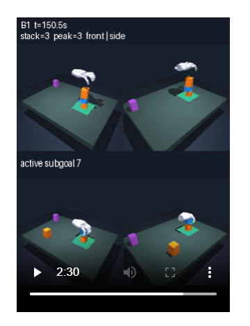
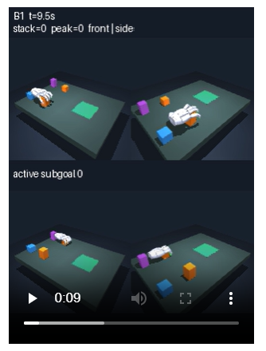
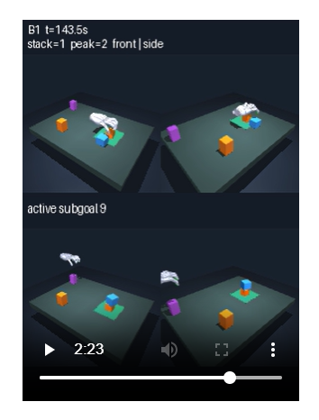
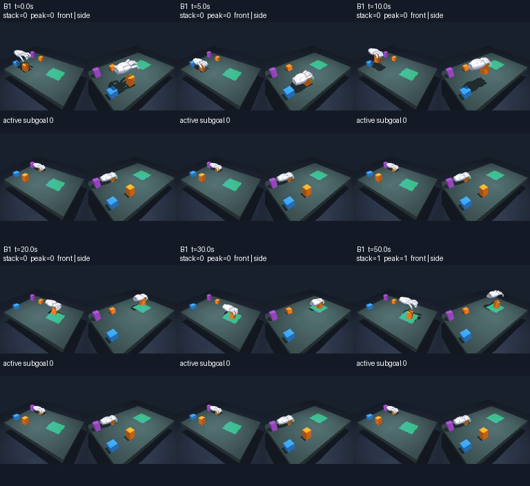
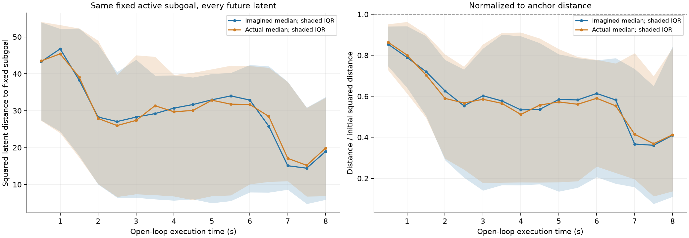

## B1 - scene-100038.sample-0

`outputs\diagnostics\scene100038-1496824\B1\episodes\scene-100038.sample-0`

peak / final = 3 / 2

- subgoal gets stuck after subgoal image #7, but the policy keeps moving on

  

## B1 - scene-100038.sample-2

`outputs\diagnostics\scene100038-1496824\B1\episodes\scene-100038.sample-2`

peak / final = 1 / 0

- The policy starts by choosing a different block from the first subgoal, stucks for 1 min and then places the first block;
- The second cube chosed by the policy is the same as the first subgoal; the hand fails to grasp the cube at first but recovers after a while.

  

## B1 - scene-100038.sample-3

`outputs\diagnostics\scene100038-1496824\B1\episodes\scene-100038.sample-2`

peak / final = 2 / 1

- The policy fails when trying to stack the second cube (blue); while it attempts to regrasp, it doesn't succeed.
- The policy chooses to grasp the first cube (orange) it has already places in the target area, and puts it back.

# Subgoal 没有很好发挥作用

1. 数据支持“子目标经常滞留”，但还不能说它完全没有发挥作用

这批 B1：

- 51/60 次在某个非最终子目标停留超过 60 秒。
- 43/60 次结束时，参考序列进度不到一半，中位数为 1/3。
- 新批次 100038/sample-2 在 48.4 秒达到第一箱，但直到 69.5 秒仍在追目标 0；之后目标 1 一直保持到结束。
- 同时，`100069/sample-0` 停在目标索引 3 超过 150 秒，仍然达到了三箱。
  这些证据更准确地支持：参考序列进度和实际任务进度发生了脱节。 goal fraction 低是诊断信号，不能直接当作任务完成率或 goal 引导强弱的度量。[统计与指标定义](/D:/cis6280-final-project/outputs/diagnostics/b1-20-1497072/analysis/REPORT.md)

# 最后一个 WM rollout latent 不一定是离subgoal最近的

实际轨迹中，34/43 个窗口曾满足目标的 latent 距离阈值，但终点只有 20/43 满足。这说明终点值会省略中途信息；不等同于已经证明另一种评分更优。可看[中途与终点的阈值满足比例图](D:/cis6280-final-project/outputs/openloop/postfirst-1497731/analysis/threshold-attainment.png)。

可以改成 score 最后 1.5s 的平均？

