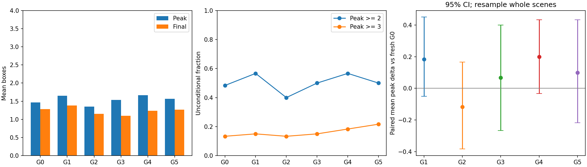
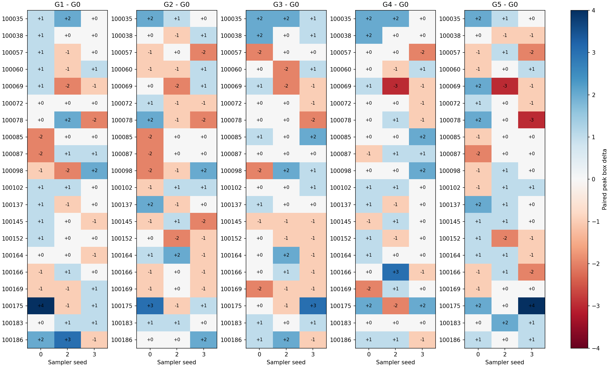
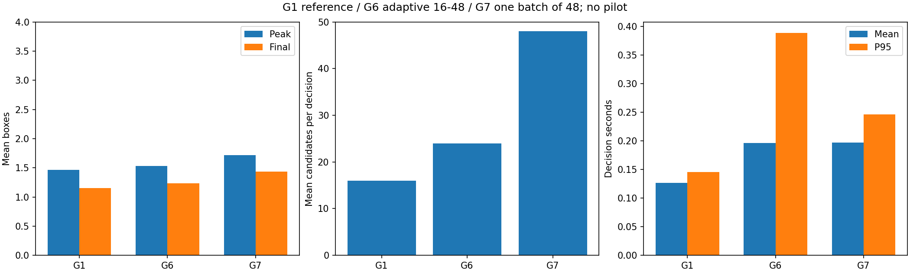
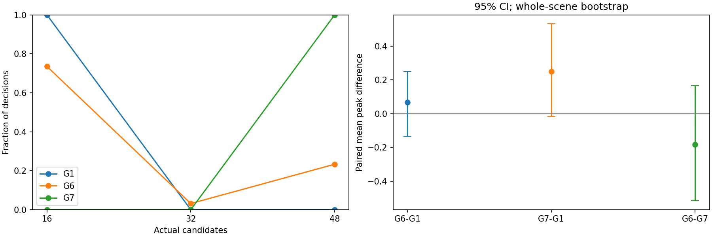

# G1–G7 实验总结与证据入口

更新日期：2026-11-04。两批实验均已完成并同步本地。**先按批次看结果，再比较方法；两批 G1 不是同一份对照。**

## 1. 主要结果

- A批（G0–G5）：G4 的 mean peak 最高（1.667），G1 的 mean final 最高（1.383）；五个处理组对 G0 的 mean peak 差异，其95%区间均包含0。G5 的 mean peak 低于 G4，但 mean final 稍高（1.267 vs 1.233）。
- B批（G1/G6/G7）：G7 的 mean peak/final 最高（1.717/1.433），G1 达到至少3箱的案例更多（12/60，对比G6/G7各10/60）。
- G6 平均每轮 23.97 条候选，G7 固定48条；两者平均决策耗时却几乎一样（196.5 vs 197.0 ms）。G7 的P95低约 36.6%。
- G7 相对同批G1的 mean peak 增加0.250，平均决策耗时增加约 55.6%；G7对G1、G6的配对 mean peak 区间都包含0，当前排序不足以证明稳定提升。

## 2. 方法定义与共同设置

| 组别 | 目标切换 | 候选评分 / 预算 |
| --- | --- | --- |
| G0（辅助对照） | 官方规则 | 第16个预测 latent 距离，16候选 |
| G1 | 官方规则 | 第13–16步距离最小值，16候选 |
| G2 | 官方规则 | 第13–16步按1:2:3:4加权，16候选 |
| G3 | 停滞后单向向前对齐 | 终点评分，16候选 |
| G4 | 停滞后双向对齐，允许回退 | 终点评分，16候选 |
| G5 | 与新G4相同的双向对齐 | pilot锁定的G2加权评分，16候选 |
| G6 | 与G1相同，官方规则 | G1尾窗最小评分；16→32→最多48，自适应补采 |
| G7 | 与G1相同，官方规则 | G1尾窗最小评分；一次采样48条 |

共同设置：冻结官方 policy、encoder、WM；16个预测blocks（8秒）；每个block为5个control steps（0.5秒）；只执行第一个block；n_steps=10、lag=0、tau=0.25。相机分辨率128，固定20个scene、sampler seeds 0/2/3；episode seed为 `scene + 1000000 * sample_seed`。目标图片仍为官方每8秒序列，距离为未另行归一化latent的平方L2。候选评分越小越好。

G3/G4/G5 的停滞条件为当前目标停留24秒，最近8秒首末各4次真实距离的中位数下降不足10%；未来/附近目标须满足 `q=D/T<1` 并连续确认3次。G4/G5 搜索当前索引±3，允许回退；重对齐当轮直接使用匹配目标，下一次真实观测才恢复官方推进。三组均无 timeout 强制前移。

G6 在累计16/32条后，仅当 `C_best>=T` 且 `r=(D_now-C_best)/max(D_now,1e-8)<0.20` 才补采；近零D_now不补采，48条无条件结束。保留较早最佳，所有批次使用同一真实上下文，额外批次只rollout新候选。G7只有一次48条的采样/rollout。不同batch形状可能改变RNG/数值结果，不要求两组候选前缀相同。

**命名沿革：旧协议 `run-1498776` 的G4是单向对齐组合组；本总结的G4是双向终点评分，G5才是双向组合组。旧G4未改名充当新组，也未纳入以下统计。** 历史G5使用G2，后续选择G1作为G6/G7基础不改变它。

## 3. 两个可比较的批次

| 批次 | 协议 / 输出ID | 全量 | GPU / workers | 用途 |
| --- | --- | --- | --- | --- |
| A | v1.1-bidirectional-r2 / bidir-1498961 | G0–G5各60，共360 | 4×2080 Ti / 8 | 评分、单向、双向及组合对照 |
| B | v1.1-sampling-r3 / sampling-1499337 | G1/G6/G7各60，共180 | 2×2080 Ti / 4 | 自适应补采与固定48对照；无pilot |

两批均使用FP16 encoder/WM autocast，policy为FP32且无policy autocast；依赖见各自run.json。A另有72个pilot记录；B没有pilot。A的兼容旧G0–G3记录按原协议/文件哈希复用，出处保留在manifest。B因分配变化重跑完整G1，**没有把A的G1结果混入B**。G1来自已看过的开发结果，全部实验仍使用同一20个开发场景，不是独立测试集。

旧L40/BF16的Phase 1、单场景A10、43窗口open-loop诊断，以及更早旧G4，不并入这两张表。

### A：G0–G5，每组60条

| 组别 | mean peak | mean final | ≥2 箱 | ≥3 箱 | 曾达4箱 / success | 平均 / P95 决策 ms |
| --- | ---: | ---: | ---: | ---: | ---: | ---: |
| G0 | 1.467 | 1.283 | 29/60 | 8/60 | 1/60 / 1/60 | 133.4 / 155.0 |
| G1 | 1.650 | 1.383 | 34/60 | 9/60 | 4/60 / 3/60 | 136.2 / 157.7 |
| G2 | 1.350 | 1.150 | 24/60 | 8/60 | 1/60 / 1/60 | 137.1 / 157.6 |
| G3 | 1.533 | 1.100 | 30/60 | 9/60 | 1/60 / 1/60 | 136.9 / 158.7 |
| G4 | 1.667 | 1.233 | 34/60 | 11/60 | 1/60 / 1/60 | 135.4 / 155.1 |
| G5 | 1.567 | 1.267 | 30/60 | 13/60 | 1/60 / 1/60 | 136.9 / 157.6 |





### B：同配置重跑的G1、G6、G7，每组60条

| 组别 | mean peak | mean final | ≥2 箱 | ≥3 箱 | 曾达4箱 / success | 平均 / P95 决策 ms | 平均候选数 |
| --- | ---: | ---: | ---: | ---: | ---: | ---: | ---: |
| G1 | 1.467 | 1.150 | 24/60 | 12/60 | 2/60 / 1/60 | 126.6 / 145.4 | 16.00 |
| G6 | 1.533 | 1.233 | 30/60 | 10/60 | 1/60 / 0/60 | 196.5 / 388.7 | 23.97 |
| G7 | 1.717 | 1.433 | 35/60 | 10/60 | 3/60 / 2/60 | 197.0 / 246.3 | 48.00 |





决策耗时是每次 `agent.step` 前后GPU同步后的wall time，包含编码、采样、rollout、评分及agent内诊断；不包含仿真control loop、视频编码或传输。mean/P95基于该组全部决策，不能把180个episode总耗时直接当成单次决策耗时。三组在各自同批使用相同worker与视频设置；共享节点负载仍可能影响计时。

## 4. 配对结果与不确定性

正号表示左侧组mean peak更高。按相同scene/seed配对；bootstrap以整个scene（保留3个sampler seeds）为单位，5000次、seed=1103。不是把60条当成60个独立场景。区间为开发性比较，未做多重比较校正。

| 同批比较 | mean peak差异 | 95% scene-bootstrap区间 | 改善 / 持平 / 退步（60条） |
| --- | ---: | --- | ---: |
| A G1-G0 | +0.183 | [-0.050, +0.450] | 24 / 19 / 17 |
| A G2-G0 | -0.117 | [-0.383, +0.167] | 19 / 15 / 26 |
| A G3-G0 | +0.067 | [-0.267, +0.400] | 20 / 21 / 19 |
| A G4-G0 | +0.200 | [-0.033, +0.433] | 22 / 24 / 14 |
| A G5-G0 | +0.100 | [-0.217, +0.433] | 24 / 17 / 19 |
| A G4-G3 | +0.133 | [-0.083, +0.350] | 20 / 25 / 15 |
| A G5-G4 | -0.100 | [-0.433, +0.233] | 17 / 19 / 24 |
| A G5-G2 | +0.217 | [+0.033, +0.417] | 19 / 31 / 10 |
| B G6-G1 | +0.067 | [-0.133, +0.250] | 20 / 25 / 15 |
| B G7-G1 | +0.250 | [-0.017, +0.533] | 26 / 16 / 18 |
| B G6-G7 | -0.183 | [-0.517, +0.167] | 21 / 16 / 23 |

G5相对较弱G2的区间高于0，但它对G0/G4的区间仍跨0；不能据此宣称组合方案普遍更好。原始配对case表和区间都已归档，无需依赖聊天文字复算。

## 5. G6预算究竟花在哪里

| 实际候选数 | 决策轮数 | 比例 |
| --- | ---: | ---: |
| 16 | 15837 | 73.52% |
| 32 | 678 | 3.15% |
| 48 | 5025 | 23.33% |

G6 共21540次决策，第二批补采率26.48%，第三批补采率23.33%；最终赢家来自第1/2/3批的轮数为 17353 / 2238 / 1949。平均每轮policy和WM各调用1.498次，G7各1次。两组最大候选预算相同，不代表实际计算量相同。

G6少采候选没有转化为本批平均耗时下降，这与多批串行调用/批处理效率相符；没有单独GPU profiler实验，不能将耗时差异全部归因于某一个原因。每批cost改善和停止原因保存在原始summary/steps中；这些是机制证据，不是任务成功率。

## 6. 计数与诊断的解释

- peak：每个control step观测到的最大有效tower箱数；final：episode结束的有效箱数。目标区内互不相连的结构不相加；手接触等条件会影响有效计数。计数下降不自动等于倒塌。
- “曾达4箱”与 `success` 不相同：官方success还要求目标计数达标且手完全释放，连续保持10个control steps。表中两项分列，避免把瞬时peak当成正式成功。
- 到第二箱的成功者耗时不代表所有episode；未完成者仍保留在episodes.csv和episode-results.jsonl中，包括第一箱后剩余观察时间。
- goal distance是平方L2；预测MSE是上一轮第一个预测latent与下一次真实latent的逐维均方差；plan change RMS是本轮首block与上轮第二block在裁剪后的raw action单位中的RMS差。
- 不同active goal的原始距离不可连成统一改善曲线，目标索引更快或发生回退本身都不是任务收益。G4/G5需要结合切换日志和真实视频查看往返行为。

## 7. 已纳入Git的证据包

入口：[evidence/manifest.json](evidence/manifest.json)。该包可在没有outputs目录、没有GPU和SSH的clone中查看。

| 文件 | 内容 |
| --- | --- |
| evidence/manifest.json | 两批身份、实际输入/源码哈希、场景/seed、GPU/dtype、来源和归档文件SHA256 |
| evidence/episode-results.jsonl | 612条完整episode summary：540条full + 72条pilot，带批次和stage标签 |
| evidence/evidence-index.jsonl | 612条原始证据路径与文件SHA256；包含视频、steps/events、tail及关键帧数量 |
| evidence/各run-id/run.json、summary.json | 按原字节复制的最终manifest和全部统计/配对case；不改写历史文件 |
| evidence/各run-id/execution.log | 原始Slurm输出，含运行前测试结果及逐episode完成记录 |
| evidence/各run-id/protocols/ | 每个stage/组实际配置；A的selection.json保留G5 pilot选择依据 |
| evidence/各run-id/episodes.csv、paired-cases.csv | episode与配对平表，保留失败和censored观察 |
| evidence/各run-id/*.png | 本文展示的图、机制图及pilot图（有明确stage，未混入full） |
| evidence/各run-id/representative-cases.json | 原报告确定性选出的改善/持平/退步案例索引；不是人工行为标注 |

原始视频和大体积steps/tail文件保留在本地/cluster，不塞进Git。全量日志没有保存每轮全部候选动作或完整latent张量。模型/目标文件未提交，但manifest提供三个输入SHA256。实验采用运行时的未提交源码快照；manifest保留当时的commit基点和实际Python源码哈希，不能声称它们运行于本次新commit。

## 8. 打开视频、取回原始证据与复现

本机已有全部数据（以下链接依赖本地outputs，不是Git仓库内文件）：

- [A批完整视频报告](../../outputs/planning/v1.1/bidir-1498961/analysis/index.html)
- [B批完整视频报告](../../outputs/planning/v1.1/sampling-1499337/analysis/index.html)

任意episode目录含 `video.mp4`、`steps.jsonl`、`events.jsonl`、`summary.json`、`timeline.png`、`objects.json`、`tail-state.json`、6张 `keyframes/*.png` 和 `complete.json`。报告提供代表案例并列播放，按对应目录可查全部失败案例。源目录见manifest的local_root/cluster_root；证据索引的relative_path相对对应根目录。

```powershell
New-Item -ItemType Directory -Force outputs/planning/v1.1 | Out-Null
scp -O -r tianzizh@grasp-login2.seas.upenn.edu:/mnt/projects/ll/tianzizh/cis6280-v11-bidir-r2/outputs/planning/v1.1/bidir-1498961 outputs/planning/v1.1/
scp -O -r tianzizh@grasp-login2.seas.upenn.edu:/mnt/projects/ll/tianzizh/cis6280-v11-sampling-r3/outputs/planning/v1.1/sampling-1499337 outputs/planning/v1.1/
```

证据包的完整性检查只需Python标准库，仓库clone后即可执行：

```text
python scripts/export_v11_evidence.py --verify
```

当上述两个原始目录齐全时，重新生成本文和证据包：

```text
python scripts/export_v11_evidence.py
```

实现入口：[agent.py](../../assignment/training/planning/agent.py)、[v11.py](../../assignment/training/planning/v11.py)、[v11_sampling.py](../../assignment/training/planning/v11_sampling.py)。
详细协议：[DESIGN.md](DESIGN.md)；实现与验证：[IMPLEMENTATION.md](IMPLEMENTATION.md)；完整运行沿革与cluster命令：[RUN.md](RUN.md)。34项关键测试与G0–G5各100次决策的旧快照等价检查已通过；测试日志原件位于对应cluster的Slurm日志。重跑命令/冻结源码目录在RUN.md中，需准备同SHA256输入和相应GPU环境；不保证跨硬件/依赖逐帧轨迹一致。
